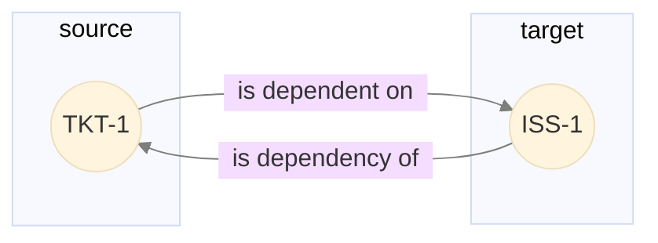
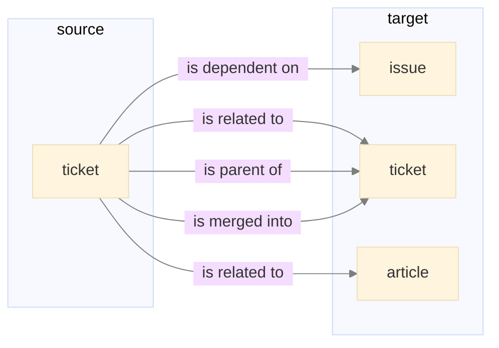
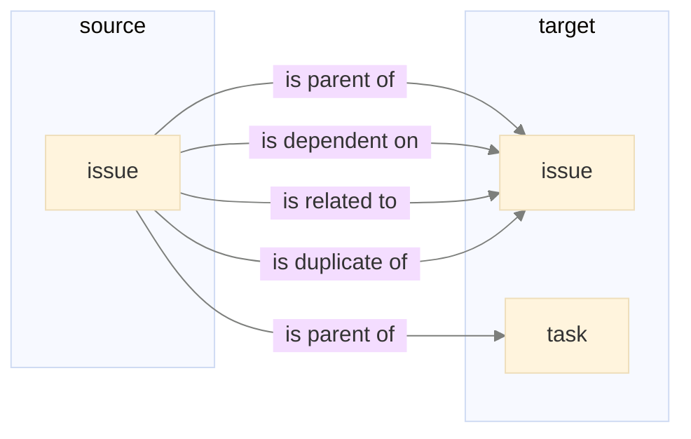

# Links

Source: <https://developer.devrev.ai/beta/guides/links>
Scraped: 2026-11-03

Links allow you to create workspace-specific relationships between any two objects in DevRev.
This feature enables you to define meaningful connections with custom names that reflect your business processes.

This section provides an overview of links and walks you through the process of creating and managing them.
By the end of this section, you'll be able to:

1. Define link types
2. Create links between objects
3. List link types
4. Update link types
5. Deprecate link types

## Concepts

### Link type

A link type defines a relationship between two types of objects. It specifies:

* The source object types that the link initiates from
* The target object types that the link can be created to
* A forward name describing the relationship from source to target
* A backward name describing the relationship from target to source

The example below shows a ticket that is dependent on an issue. The backward name for the relationship "is dependency of" is shown in the reverse direction.



### Supported object types

Links can be created between the following object types:

* custom object
* work (issue, ticket, task, opportunity)
* account, user
* part (product, capability, feature, enhancement)

For more details on customization or custom object concepts, please refer to the documentation below:

* [Customization](../../guides/object-customization.md)
* [Custom objects](../../guides/custom-objects.md)

### Default link types

Every DevRev workspace is automatically provisioned with a set of default link types. These define the standard relationships between built-in object types, such as parent-child, related, dependency, and more. The default link types specify the allowed source and target object types, forward and backward names, and constraints for each relationship.

They are automatically created when a workspace is provisioned, and cannot be modified.

To retrieve the default link types for your workspace, use the list endpoint:

```bash
curl --location 'https://api.devrev.ai/link-types.custom.list' \
--header 'Content-Type: application/json' \
--header 'Authorization: Bearer <TOKEN>' \
--data '{}'
```

Default link types are identified by `is_default` set to `true` in the response:

```json title="Response"
{
    "custom_link_types": [
        {
            "id": "don:core:dvrv-us-1:devo/demo:custom_link_type/default-1",
            "name": "Parent Child",
            "forward_name": "Parent",
            "backward_name": "Child",
            "source_types": [{ "leaf_type": "ticket" }],
            "target_types": [{ "leaf_type": "ticket" }],
            "is_default": true
        }
    ]
}
```

> **Note:**
>   Both default and user-created link types are managed through the same API endpoints (`link-types.custom.*`).

## Create link types

> **Note:**
>   Let's say you want to establish a parent-child relationship between tickets and a custom object
>   type called "Campaign". This relationship helps track which tickets are assigned to which campaigns.

To create this relationship, make an API call to create a link type:

```bash
curl --location 'https://api.devrev.ai/link-types.custom.create' \
--header 'Content-Type: application/json' \
--header 'Authorization: Bearer <TOKEN>' \
--data '{
    "name": "Link between ticket and campaign",
    "source_types": [
        {
            "leaf_type": "ticket"
        }
    ],
    "target_types": [
        {
            "leaf_type": "campaign",
            "is_custom_leaf_type": true
        }
    ],
    "forward_name": "is parent of",
    "backward_name": "is child of"
}'
```

The link type above defines:

* A descriptive name
* Source types that the link can be created from (ticket)
* Target types that the link can be created to (campaign custom object)
* Forward name ("is parent of") describing the relationship from ticket to campaign
* Backward name ("is child of") describing the relationship from campaign to ticket

> **Note:**
>   A custom link type can have a maximum of 30 source types and 30 target types.

### Uniqueness and deduplication

Each custom link type has an identity derived from its `name`, along with the unordered pair of (`source_types`, `target_types`). When you call `link-types.custom.create`, the server checks for an existing link type with the same identity before creating a new one:

* If no match exists, a new custom link type is created.
* If a match exists and every other field — `forward_name`, `backward_name`, `tooltip`, `constraints`, `fields`, `ui` — is identical to the request, the call is idempotent and returns the existing link type.
* If a match exists but any of those fields differ, the request is rejected with `409 Conflict`.

A few practical consequences:

* The order of entries within `source_types` (and within `target_types`) does not matter.
* Swapping `source_types` with `target_types` in a subsequent `create` call does not produce a new link type; the existing link type with the same `name` is returned.
* Forward and backward directions of a relationship are expressed on a single link type via `forward_name` and `backward_name` (see [Bidirectional link creation](#bidirectional-link-creation)); a separate link type for the reverse direction is not required.
* Deduplication only applies to `link-types.custom.create`. To modify any field of an existing link type, use [`link-types.custom.update`](#update-link-types).

## Create links between objects

Once you have a link type (either a default or one you've created), you can create links between objects:

```bash
curl --location 'https://api.devrev.ai/links.create' \
--header 'Content-Type: application/json' \
--header 'Authorization: Bearer <TOKEN>' \
--data '{
    "custom_link_type": "don:core:dvrv-us-1:devo/demo:custom_link_type/1",
    "source": "don:core:dvrv-us-1:devo/demo:ticket/1",
    "target": "don:core:dvrv-us-1:devo/demo:custom_object/campaign/1"
}'
```

> **Tip:**
>   When creating a link:

  1. Provide the link type ID in `custom_link_type`.
  2. Ensure both source and target objects exist.

> **Warning:**
>   The `link_type` enum field is deprecated. Use the link type ID (passed in `custom_link_type`) instead. This works for both default and user-created link types. The API remains backward compatible—requests using the `link_type` enum continue to work, but new integrations should use the link type ID.

### Bidirectional link creation

When creating a link, you don't need to worry about which object to specify as the source and which as the target. The API automatically normalizes the direction to match the link type definition.

For example, if you create a "related to" link from a conversation to a ticket, the system resolves this against the corresponding default link type definition and creates the link from ticket to conversation. The link is still bidirectional—it can be traversed in both directions using the forward and backward names—but the stored state always adheres to the link type definition.

> **Tip:**
>   You can provide the source and target in any order when creating a link. The system ensures the link is stored consistently according to the link type definition.

## List link types

You can list link types in your workspace, with optional filtering:

```bash
curl --location 'https://api.devrev.ai/link-types.custom.list' \
--header 'Content-Type: application/json' \
--header 'Authorization: Bearer <TOKEN>' \
--data '{
    "source_types_v2": [
        {
            "leaf_type": "ticket"
        }
    ]
}'
```

### Bidirectional list results

When you filter by `source_types_v2` or `target_types_v2`, the response returns two arrays:

* `result`—link types where your filter matches the defined source and target types directly.
* `reverse_result`—link types where your filter matches in the reverse direction, that is, the filtered source type matches the defined target type, or vice versa. Objects can be present in both `result` and `reverse_result`.

For example, filtering with `source_types_v2: [{ "leaf_type": "ticket" }]` returns:

```json title="Response"
{
    "result": [
        {
            "id": "don:core:dvrv-us-1:devo/demo:custom_link_type/default-1",
            "name": "Parent Child",
            "forward_name": "Parent",
            "backward_name": "Child",
            "source_types": [{ "leaf_type": "ticket" }],
            "target_types": [{ "leaf_type": "ticket" }]
        }
    ],
    "reverse_result": [
        {
            "id": "don:core:dvrv-us-1:devo/demo:custom_link_type/default-20",
            "name": "Dependent On",
            "forward_name": "Dependent",
            "backward_name": "Dependency",
            "source_types": [{ "leaf_type": "ticket" }, { "leaf_type": "incident" }],
            "target_types": [{ "leaf_type": "issue" }]
        }
    ]
}
```

In this example, "Parent Child" appears in `result` because ticket is defined as its source type. "Dependent On" appears in `reverse_result` because the filter matched ticket on the opposite side of the relationship (ticket is a source type, but the filter found it relevant in reverse).

> **Tip:**
>   Use both arrays to get the complete picture of link types relevant to a given object type. The `limit` parameter applies independently to each array, and not as sum of both.

## Update link types

> **Note:**
>   Now, you want to expand the source types to allow both issues and tickets to have this relationship
>   with campaigns.

You can update the existing link type to include additional source types:

```bash
curl --location 'https://api.devrev.ai/link-types.custom.update' \
--header 'Content-Type: application/json' \
--header 'Authorization: Bearer <TOKEN>' \
--data '{
    "id": "don:core:dvrv-us-1:devo/demo:custom_link_type/1",
    "name": "Link type between issue/ticket and campaign",
    "source_types_v2": [
        {
            "leaf_type": "issue"
        },
        {
            "leaf_type": "ticket"
        }
    ]
}'
```

> **Note:**
>   A custom link type can have a maximum of 30 source types and 30 target types.

## Restrict links by subtype

You can restrict which objects are allowed in a link by using the `subtype` and `leaf_only` fields in the source or target type descriptors:

| Field       | Type    | Description                                                                                                                |
| :---------- | :------ | :------------------------------------------------------------------------------------------------------------------------- |
| `subtype`   | string  | Restricts the link to objects of a specific subtype.                                                                       |
| `leaf_only` | boolean | When `true`, only objects of the exact leaf type are allowed (objects with any subtype are excluded). Defaults to `false`. |

> **Note:**
>   For example, you may want to only allow issues of a particular subtype to be linked to tickets.

```bash {9}
curl --location 'https://api.devrev.ai/link-types.custom.create' \
--header 'Content-Type: application/json' \
--header 'Authorization: Bearer <TOKEN>' \
--data '{
    "name": "Link between social media issues and tickets",
    "source_types": [
        {
            "leaf_type": "issue",
            "subtype": "social_media"
        }
    ],
    "target_types": [
        {
            "leaf_type": "ticket"
        }
    ],
    "forward_name": "is related to",
    "backward_name": "is related to"
}'
```

This configuration:

* Allows issues of subtype "social\_media" to be linked to tickets
* Rejects attempts to link issues with no subtype or with other subtypes

> **Tip:**
>   The subtype must exist for the corresponding object type.
>   To add more valid source subtypes, use the update endpoint to add them to the `source_types_v2` array.

## Deprecate link types

> **Note:**
>   Link types cannot be deleted, only deprecated. This ensures that existing links maintain
>   referential integrity and prevents data corruption.

To deprecate a link type, use the update endpoint and set `is_deprecated` to `true`:

```bash {6}
curl --location 'https://api.devrev.ai/link-types.custom.update' \
--header 'Content-Type: application/json' \
--header 'Authorization: Bearer <TOKEN>' \
--data '{
    "id": "don:core:dvrv-us-1:devo/demo:custom_link_type/1",
    "is_deprecated": true
}'
```

## Default links from tickets and issues

> **Info:**
>   This section lists the default link types available for tickets and issues. The diagrams show the stored direction as defined by the default link types. Because links are bidirectional, you can provide the objects in either order when making API calls. This is not an exhaustive list. To retrieve all available link types, use the [list endpoint](#list-link-types).

### Default links from tickets



### Default links from issues



### Behavior and constraints by link type

| Link type       | Multiple incoming to a target | Multiple outgoing from a source | Cycles allowed | Max levels (depth) | Where these limits matter most                                                                       |
| :-------------- | :---------------------------- | :------------------------------ | :------------- | :----------------- | :--------------------------------------------------------------------------------------------------- |
| is parent of    | No                            | Yes                             | No             | 2                  | Applies to ticket ↔ ticket and issue ↔ issue parent chains; also when parenting tasks                |
| is related to   | Yes                           | Yes                             | Yes            | No fixed limit     | General “related” networks are flexible                                                              |
| is merged into  | Yes                           | No                              | No             | 2                  | Ticket merges (ticket → ticket)                                                                      |
| is follow up of | No                            | No                              | No             | No constraint      | Constraints are enforced only for ticket → ticket; outside that pair, constraints may not be checked |
| is dependent on | Yes                           | Yes                             | Yes            | No fixed limit     | Ticket → issue, issue → issue, issue → code change                                                   |
| is duplicate of | No constraint                 | No constraint                   | No constraint  | No constraint      | For example, issue → issue; no additional constraints configured                                     |
