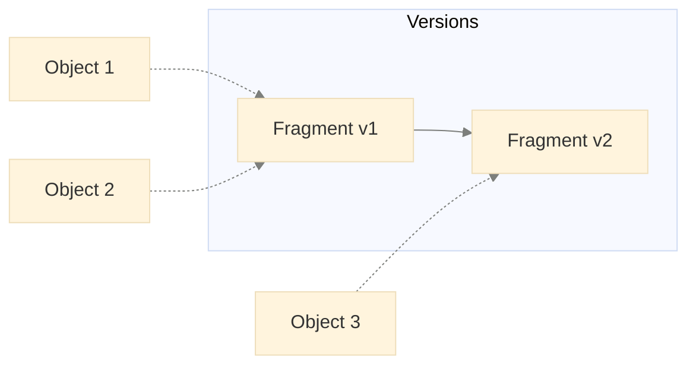
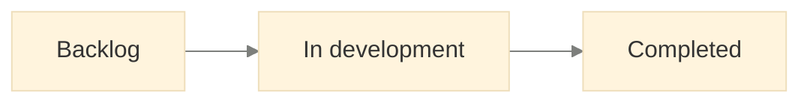
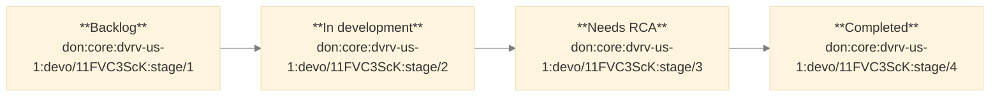

# Object customization

Source: <https://developer.devrev.ai/guides/object-customization>
Scraped: 2026-11-03

DevRev allows you to customize its core objects such as *issue* and *ticket* to fit
your organization's unique workflows and reporting needs. By using the customization
framework, you can extend these objects with custom fields that reflect your processes.

This section provides an overview of the customization framework and walks you through the
process of tracking bugs in your organization. By the end of this section, you'll be able
to:

1. Customize DevRev objects such as *issue* and *ticket* by adding custom fields.
2. Override default field settings of DevRev objects.
3. Create custom stages and stage transition diagrams for your objects.
4. Create dependent fields for your objects.

## Concepts

### DevRev object

DevRev objects are the core entities that represent real-world items such as issues,
tickets, and incidents. Each object type has a set of fields that describe the object.

> **Tip:**
>   When you encounter `leaf_type` in the documentation or API, it refers to the type of DevRev
>   object you're working with, such as an *issue* or *ticket*.

### Schema fragment

DevRev objects are customized using *schema fragments*. A fragment is a building block
that defines a specific set of custom fields. When creating or updating an object
record, multiple schema fragments can be combined to determine the full set of custom
fields available for that record. The term *fragment* is used because each schema
fragment contributes a portion of the overall object schema.

### Tenant custom field

Tenant custom fields allow extending the DevRev objects by adding new fields. These
custom fields are applied to all records of the specified object type within the
organization. For example, a release notes tenant custom field for *issue* is applicable
to all *issue* records in the organization.

Tenant custom fields are defined in a schema fragment of type `tenant_fragment`.

### Subtype

Subtypes are kinds of DevRev object types. They inherit all fields from the parent type
and can include additional specific fields. For example, a *bug* subtype of
*issue* would have all *issue* fields plus *bug*-specific fields like *RCA*.

Subtypes are defined using a schema fragment of type `custom_type_fragment`.

### App custom field

App custom fields allow extending the DevRev objects by adding automation (which includes snap-ins) specific new fields. These
custom fields are applied to the records only by the automation that defines them for a given object type
within the organization. For example, email subject custom field for *issue* is applicable only
to the *issue* records created by the *email\_integration* snap-in.

App custom fields are defined in a schema fragment of type `app_fragment`.

> **Tip:**
>   App custom fields are shown in the UI only if the automation that defines them is installed in the organization
>   and the automation has created or updated the records.

## Customize DevRev objects

> **Note:**
>   Your team needs to track software bugs. You want to know:

  * Which environments are affected (development, testing, production)
  * Whether it's a regression (a bug in previously working code)
  * The root cause analysis (RCA) of the bug

First, create a schema fragment defining the fields for the *bug* subtype.
Make sure to replace `` with your API token.

```bash
curl --location 'https://api.devrev.ai/schemas.custom.set' \
--header 'Content-Type: application/json' \
--header 'Authorization: Bearer <TOKEN>' \
--data '{
    "type": "custom_type_fragment",
    "description": "Attributes for tracking a bug",
    "leaf_type": "issue",
    "subtype": "bug",
    "subtype_display_name": "Bug",
    "fields": [
        {
            "name": "impacted_environments",
            "field_type": "array",
            "base_type": "enum",
            "allowed_values": [ "Dev", "QA", "Prod" ],
            "is_filterable": true,
            "ui": {
                "display_name": "Impacted Environments",
            }
        },
        {
            "name": "regression",
            "field_type": "bool",
            "ui": {
                "display_name": "Regression",
            }
        },
        {
            "name": "rca",
            "field_type": "rich_text",
            "ui": {
                "display_name": "RCA",
            }
        },
    ]
}'
```

> **Note:**
>   A bug has been identified in the production environment. The reporter creates a
>   *bug*-flavored *issue* object to track it and assigns a relevant owner.

```bash {11-17}
curl --location 'https://api.devrev.ai/works.create' \
--header 'Content-Type: application/json' \
--header 'Authorization: Bearer <TOKEN>' \
--data '{
    "type": "issue",
    "title": "API failure in Prod",
    "owned_by": "<OWNER_ID>",

    ... // other required fields

    "custom_schema_spec": {
        "subtype": "bug"
    },
    "custom_fields": {
        "ctype__impacted_environments": [ "QA", "Prod" ]
        "ctype__regression": true,
    }
}'
```

After resolving the bug, the developer can update the issue object with release
notes. Adding release notes provides a clear record of what was deployed to resolve the
bug which can be valuable for future reference and communication with stakeholders.

To add release notes for the completed work, you can create a tenant custom field for
the *issue*.

> **Tip:**
>   Since release notes are relevant to all issues, a tenant custom field is used instead of
>   a subtype-specific field.

```bash
curl --location 'https://api.devrev.ai/schemas.custom.set' \
--header 'Content-Type: application/json' \
--header 'Authorization: Bearer <TOKEN>' \
--data '{
    "type": "tenant_fragment",
    "description": "Tenant attributes for issues",
    "leaf_type": "issue",
    "fields": [
        {
            "name": "release_notes",
            "field_type": "rich_text",
            "ui": {
                "display_name": "Release Notes",
            }
        }
    ]
}'
```

Populate the release notes in the issue object created above:

```bash {8-13}
curl --location 'https://api.devrev.ai/works.update' \
--header 'Content-Type: application/json' \
--header 'Authorization: Bearer <TOKEN>' \
--data '{
    "id": "don:core:dvrv-us-1:devo/test:issue/1",
    "type": "issue",
    "custom_schema_spec": {
        "tenant_fragment": true
    },
    "custom_fields": {
        "tnt__release_notes": "<RELEASE_NOTES>"
    }
}'
```

The final issue object now looks as follows:

```json {10-19}
{
    "id": "don:core:dvrv-us-1:devo/test:issue/1",
    "type": "issue",
    "title": "API failure in Prod",
    "display_id": "ISS-1",
    "created_by": {...},
    "created_date": "2024-10-11T06:48:57.759Z",
    "modified_date": "2024-10-11T06:55:29.183Z",
    "stage": "resolved",
    "custom_fields": {
        "ctype__regression": true,
        "ctype__impacted_environments": [ "Prod" ],
        "tnt__release_notes": "<RELEASE_NOTES>"
    },
    "subtype": "bug",
    "custom_schema_fragments": [
        "don:core:dvrv-us-1:devo/test:custom_type_fragment/1"
        "don:core:dvrv-us-1:devo/test:tenant_fragment/1",
    ]
}
```

The following observations can be made from the above example:

* The custom fields defined by different fragments are held in different namespaces in an object.
  * Subtype fields are of the form `ctype__<field_name>`.
  * Tenant fields are of the form `tnt__<field_name>`.
* References to each fragment are stored with the object.
* When updating an object, the `custom_schema_spec` can specify only the fragments being
  modified. Here, only the tenant fragment is specified as only the release notes field
  is being updated.

## Supported custom field types

The following custom field types are supported -

| Type       | Example                                  |
| ---------- | ---------------------------------------- |
| int        | `42`                                     |
| double     | `3.14`                                   |
| bool       | `true`                                   |
| tokens     | `"apple"`                                |
| text       | `"Hello, world!"`                        |
| rich\_text | `"**Hello**, world!"`                    |
| enum       | `"apple"`                                |
| timestamp  | `"2020-10-20T00:00:00Z"` (RFC3339)       |
| date       | `"2020-10-20"` (YYYY-MM-DD)              |
| id         | `"don:core:dvrv-us-1:devo/test:issue/1"` |

The list variants of all the supported custom field types are also supported.
In the example above, the `impacted_environments` field is a list of enum values.

## Custom field naming and prefixes

Custom fields live in a nested `custom_fields` object, and each field name must carry a prefix identifying the schema fragment that defines it. The prefix keeps fields from different fragments in separate namespaces so their names never collide.

| Fragment type                  | Field prefix             | Example                          |
| ------------------------------ | ------------------------ | -------------------------------- |
| Tenant fragment                | `tnt__`                  | `tnt__release_notes`             |
| Subtype (custom type fragment) | `ctype_<subtype-name>__` | `ctype_bug__rca`                 |
| App fragment                   | `app_<app-name>__`       | `app_email_integration__subject` |

> 📝 **Note**: The double underscore (`__`) separates the prefix from the field name.

### Bad request errors on works.create

If `works.create` or `works.update` returns a `400 Bad Request` when you send `custom_fields`, the most common cause is a field name without the correct prefix. Both of the following must be true:

* Each custom field name is prefixed as shown above.
* The matching fragment is declared in `custom_schema_spec` — set `tenant_fragment: true` for `tnt__` fields, name the `subtype` for `ctype_…__` fields, and list the `apps` for `app_…__` fields.

A field sent without its prefix (or without its fragment declared in `custom_schema_spec`) is treated as unknown and the request is rejected.

## Unified enum (uenum) fields

Unified enum fields, also called uenum or displayed as dropdown in the Object Customization UI, are an advanced type of enum field that use numeric IDs instead of string values. This enables you to rename labels, reorder options, and deprecate values without affecting existing data.

### When to use uenum fields

Use uenum fields when you need:

* **Custom sort order** - Define display order independently from alphabetical sorting.
* **Relabeling without data loss** - Change option labels without affecting existing records.
* **Stable programmatic access** - Use numeric IDs in APIs and automation.
* **Option deprecation** - Mark options as deprecated while preserving existing data.

> **Tip:**
>   For simple dropdowns that won't need relabeling or custom ordering, regular `enum` fields are simpler. Use `uenum` when you need the advanced capabilities described above.

### Uenum field structure

Each uenum option consists of:

| Property     | Type    | Required | Description                                                            |
| ------------ | ------- | -------- | ---------------------------------------------------------------------- |
| `id`         | integer | Yes      | Immutable unique identifier for programmatic access                    |
| `label`      | string  | Yes      | Human-readable display name (can be changed)                           |
| `ordinal`    | integer | Yes      | Determines display order (lower values appear first)                   |
| `deprecated` | boolean | No       | If `true`, cannot be set on new objects but existing data is preserved |

### Create a uenum field

> **Note:**
>   You want to track issue priority with custom priority levels that can be reordered and relabeled as your processes evolve.

```bash
curl --location 'https://api.devrev.ai/schemas.custom.set' \
--header 'Content-Type: application/json' \
--header 'Authorization: Bearer <TOKEN>' \
--data '{
    "type": "tenant_fragment",
    "description": "Custom priority levels for issues",
    "leaf_type": "issue",
    "fields": [
        {
            "name": "custom_priority",
            "field_type": "uenum",
            "is_filterable": true,
            "allowed_values": [
                {
                    "id": 1,
                    "label": "Low",
                    "ordinal": 100
                },
                {
                    "id": 2,
                    "label": "Medium",
                    "ordinal": 200
                },
                {
                    "id": 3,
                    "label": "High",
                    "ordinal": 300
                },
                {
                    "id": 4,
                    "label": "Critical",
                    "ordinal": 400
                }
            ],
            "default_value": 2,
            "ui": {
                "display_name": "Priority"
            }
        }
    ]
}'
```

Key points:

* Each option in `allowed_values` must have a unique `id`.
* The `ordinal` values determine display order (100, 200, 300, 400 allows easy reordering).
* The `default_value` references the `id` (not the label).
* The `field_type` is `"uenum"` for single-select or `"uenum[]"` for multi-select.

### Set uenum values

When creating or updating objects, set uenum fields using the numeric `id`:

```bash
curl --location 'https://api.devrev.ai/works.create' \
--header 'Content-Type: application/json' \
--header 'Authorization: Bearer <TOKEN>' \
--data '{
    "type": "issue",
    "title": "Critical bug in payment processing",
    "custom_schema_spec": {
        "tenant_fragment": true
    },
    "custom_fields": {
        "tnt__custom_priority": 4
    }
}'
```

The API returns the uenum field with its ID and ordinal in responses:

```json {7-10}
{
    "work": {
        "id": "don:core:dvrv-us-1:devo/test:issue/123",
        "type": "issue",
        "title": "Critical bug in payment processing",
        "custom_fields": {
            "tnt__custom_priority": {
                "id": 4,
                "ordinal": 400
            }
        }
    }
}
```

### Manage uenum values

#### Relabel options

You can change labels without affecting existing data. The `id` remains the same, so all existing records automatically show the new label:

```json {5-8}
{
    "allowed_values": [
        {"id": 1, "label": "P3 - Low", "ordinal": 100},
        {"id": 2, "label": "P2 - Medium", "ordinal": 200},
        {"id": 3, "label": "P1 - High", "ordinal": 300},
        {"id": 4, "label": "P0 - Critical", "ordinal": 400}
    ]
}
```

#### Reorder options

Change the `ordinal` values to reorder options in dropdowns:

```json {2-5}
{
    "allowed_values": [
        {"id": 4, "label": "P0 - Critical", "ordinal": 100},
        {"id": 3, "label": "P1 - High", "ordinal": 200},
        {"id": 2, "label": "P2 - Medium", "ordinal": 300},
        {"id": 1, "label": "P3 - Low", "ordinal": 400}
    ]
}
```

> **Warning:**
>   After changing ordinal values, existing objects store the old ordinal values until they're upgraded. This can cause inconsistent sort order in queries. Trigger an object upgrade to update all records to the latest ordinal values.

#### Add new options

Add new entries to the `allowed_values` array with unique IDs:

```json {5-10}
{
    "allowed_values": [
        {"id": 1, "label": "P3 - Low", "ordinal": 100},
        {"id": 2, "label": "P2 - Medium", "ordinal": 200},
        {"id": 3, "label": "P1 - High", "ordinal": 300},
        {"id": 4, "label": "P0 - Critical", "ordinal": 400},
        {"id": 5, "label": "P0 - Blocker", "ordinal": 50}
    ]
}
```

#### Deprecate options

Mark an option as deprecated to prevent new uses while preserving existing data:

```json {3}
{
    "allowed_values": [
        {"id": 1, "label": "P3 - Low", "ordinal": 100, "deprecated": false},
        {"id": 2, "label": "Legacy Priority", "ordinal": 200, "deprecated": true},
        {"id": 3, "label": "P1 - High", "ordinal": 300, "deprecated": false},
        {"id": 4, "label": "P0 - Critical", "ordinal": 400, "deprecated": false}
    ]
}
```

Effects of deprecation:

* Cannot be set on new or updated objects.
* Retained in existing objects.
* Still appears in API responses for objects that have it.
* Hidden from dropdowns in the UI.

> **Tip:**
>   Deprecate options first, monitor usage, and only remove them after confirming no active use. Removing an option causes data loss for objects using that value.

### Filter, sort, and group by uenum fields

#### Filter

Filter by uenum value using the field name:

```json {4}
{
    "type": ["issue"],
    "custom_fields": {
        "tnt__custom_priority": [3, 4]
    }
}
```

#### Sort

Use the `.ordinal` suffix to sort by display order:

```json {3}
{
    "type": ["issue"],
    "sort_by": ["custom_fields.tnt__custom_priority.ordinal"]
}
```

#### Group

Use the `.id` suffix to group by uenum value:

```json {3}
{
    "type": ["issue"],
    "group_by": ["custom_fields.tnt__custom_priority.id"]
}
```

### Uenum vs enum fields

| Feature             | Enum              | Uenum                       |
| ------------------- | ----------------- | --------------------------- |
| Stored as           | String label      | Numeric ID + ordinal        |
| Relabeling          | Causes data loss  | Preserves data              |
| Custom ordering     | Alphabetical only | Fully customizable          |
| Programmatic access | String matching   | Stable numeric IDs          |
| Deprecation         | Not supported     | Supported                   |
| API syntax          | `"value"`         | `3` (ID)                    |
| Response format     | `"value"`         | `{"id": 3, "ordinal": 300}` |

> **Warning:**
>   Converting between `enum` and `uenum` is not supported due to incompatible data representations. To migrate, create a new uenum field, backfill data from the enum field, update applications, then deprecate the old enum field.

## Filter DevRev objects

> **Note:**
>   To demonstrate filtering capabilities, consider finding all bugs in the production
>   environment that had a customer impact.

This translates to filtering *issue* objects with subtype *bug*, *customer\_impact* set
to `true` and *impacted\_environments* containing `"Prod"`.

```bash
curl --location 'https://api.devrev.ai/works.list' \
--header 'Content-Type: application/json' \
--header 'Authorization: Bearer <TOKEN>' \
--data '{
    "type": [ "issue" ],
    "issue": {
        "subtype": [ "bug" ]
    },
    "custom_fields": {
        "ctype__customer_impact": [ true ],
        "ctype__impacted_environments": [ "Prod" ]
    }
}'
```

Note that both *customer\_impact* and *impacted\_environments* are filterable fields,
marked with `is_filterable: true` above.

## Schema fragment versioning

Schema fragments are immutable. When evolving a fragment:

1. A new fragment is created and chained to the older one.
2. The older fragment remains intact.
3. Objects referencing the older fragment are unaffected (more on this later).

The same API endpoint `schemas.custom.set` is used to create and update fragments. The
API internally figures out how to version and chain the fragments.

> **Note:**
>   You want to add a new boolean field *customer\_impact* to the *bug* subtype
>   and delete the *regression* field.

The API call to add the new field and delete the old field is shown below:

```bash {28-36}
curl --location 'https://api.devrev.ai/schemas.custom.set' \
--header 'Content-Type: application/json' \
--header 'Authorization: Bearer <TOKEN>' \
--data '{
    "type": "custom_type_fragment",
    "description": "Attributes for tracking a bug",
    "leaf_type": "issue",
    "subtype": "bug",
    "fields": [
        {
            "name": "impacted_environments",
            "field_type": "array",
            "base_type": "enum",
            "allowed_values": [ "Dev", "QA", "Prod" ],
            "is_filterable": true,
            "ui": {
                "display_name": "Impacted Environments",
            }
        },
        {
            "name": "rca",
            "field_type": "rich_text",
            "ui": {
                "display_name": "RCA",
            }
        },
        {
            "name": "customer_impact",
            "field_type": "bool",
            "is_filterable": true,
            "ui": {
                "display_name": "Customer Impact",
            }
        }
    ],
    "deleted_fields": [ "regression" ]
}'
```

Note that:

* The API payload reflects the entire state of the new fragment version.
* The `deleted_fields` array specifies the field names that are being deleted. If not
  provided, the API call fails due to the lack of an explicit field deletion
  confirmation. This prevents accidental field deletions.

The above API call internally performs the following steps:

1. Creates a new fragment with the specified payload.
2. Updates the new fragment to point to the previous fragment. The `old_fragment_ref`
   system field in the new fragment points to the previous fragment.
3. Updates the old fragment to point to the new fragment. The `new_fragment_ref` system
   field in the old fragment points to the new fragment.

The diagram below shows the relationship between the fragments and how the versioning
scheme preserves the referential integrity.



### Object upgrades

A natural question arises at this point: what happens to the objects referencing the
old fragment version?

The object get and list APIs automatically upgrade the object **in-memory** to the
latest fragment version when queried. The necessary field adjustments are done in this
process. In the example above, when the object referencing the old fragment is read, the
*regression* field is dropped in the response.

```bash {16-18, 21}
curl --location 'https://api.devrev.ai/works.get' \
--header 'Content-Type: application/json' \
--header 'Authorization: Bearer <TOKEN>' \
--data '{
    "id": "don:core:dvrv-us-1:devo/test:issue/2"
}'

{
    "work": {
        "id": "don:core:dvrv-us-1:devo/test:issue/2",
        "type": "issue",
        "title": "Critical Service Outage",
        "display_id": "ISS-x",
        "created_by": {...},
        "created_date": "2024-10-12T08:30:15.123Z",
        "custom_fields": {
            "ctype__impacted_environments": [ "Prod" ]
        },
        "subtype": "bug",
        "custom_schema_fragments": [
            "don:core:dvrv-us-1:devo/test:custom_type_fragment/2"
            "don:core:dvrv-us-1:devo/test:tenant_fragment/1",
        ]
    }
}
```

The object now references the latest fragment version (`custom_type_fragment/2`). While
the optional release notes field is absent, the tenant fragment remains attached,
allowing for future tenant-specific field additions.

#### Bulk upgrades

All objects of a given type can be upgraded to the latest fragment version using the
`objects.bulk-upgrade` API. It is an async API that schedules a job to scan all the
objects of the given type and upgrade them.

```bash {16-18, 21}
curl --location 'https://api.devrev.ai/internal/objects.bulk-upgrade' \
--header 'Content-Type: application/json' \
--header 'Authorization: Bearer <TOKEN>' \
--data '{
    "type": "issue"
}
```

## Deprecate custom schema fragments

Custom schema fragments can be deprecated to avoid creating work items using them. The
following POST request payload to `schemas.custom.set` can be used:

```json {9}
{
    "type": "custom_type_fragment",
    "description": "Attributes for tracking a bug",
    "leaf_type": "issue",
    "subtype": "bug",
    "fields": [
        ...
    ],
    "is_deprecated": true,
}
```

## List custom schema fragments

The following API call can be used to list all the custom schema fragments in your
organization:

```bash
curl --location 'https://api.devrev.ai/schemas.custom.list' \
--header 'Content-Type: application/json' \
--header 'Authorization: Bearer <TOKEN>'
```

Deprecated fragments aren't listed in the response.

## Configure UI hints

UI hints allow customizing the UI/UX of custom fields. So far, `ui.display_name` has
been used to set the display name of a field. Let's look at the other supported UI
hints:

* `display_name`: The display name of the field.
* `is_hidden`: Whether the field is hidden.
* `placeholder`: The placeholder text for the field.
* `is_sortable`: Whether the field is sortable. Requires `is_filterable` to be true.
* `is_groupable`: Whether the field is groupable. Requires `is_filterable` to be true.
* `order`: The order in which the field appears in the side panel.
* `is_read_only`: Whether the field is read-only in the UI. Once the object is created, this
  field cannot be updated in the UI.
* `group_name`: The group title under which field(s) appear in the side panel. In the
  example below, the fields are grouped under groups titled **Group 1** and **Group 2**.

  *[image: customization-group_name-ui-hint — see source page]*
* `unit`: The unit for the field. For example, days, kg. The unit is displayed
  in the side panel as shown below:

  *[image: customization-unit-ui-hint — see source page]*

> **Tip:**
>   `is_filterable` is not a UI hint but a top level field property.

## Override stock fields

The fields available in native DevRev objects are called stock fields. For example,
`priority` is a stock field of *issue*.

> **Note:**
>   You want to do the following modifications to the priority field in your organization:

  1. Update the UI display name from *Priority* to *Urgency Level*.
  2. Update the allowed values from *P0*, *P1*, *P2*, and *P3* to *Low*, *Medium*, *High*, and *Blocker*.

Since the modification is applicable to all issues, you can create a tenant schema
fragment with the following payload:

```bash
curl --location 'https://api.devrev.ai/internal/schemas.custom.set' \
--header 'Content-Type: application/json' \
--header 'Authorization: Bearer <TOKEN>' \
--data '{
  "type": "tenant_fragment",
  "leaf_type": "issue",
  "description": "Stock field overrides demo",
  "fields": [],
  "stock_field_overrides": [
    {
      "name": "priority_v2",
      "uenum_values": [
        {
          "id": 1,
          "label": "Blocker",
          "ordinal": 1
        },
        {
          "id": 2,
          "label": "High",
          "ordinal": 2
        },
        {
          "id": 3,
          "label": "Medium",
          "ordinal": 3
        },
        {
          "id": 4,
          "label": "Low",
          "ordinal": 4
        }
      ],
      "ui": {
        "display_name": "Urgency Level",
      }
    }
  ]
}'
```

A few observations can be made from the above payload:

* The `stock_field_overrides` array contains the overrides for the stock fields.
* The `name` field in the override specifies the stock field to be overridden.
* The `uenum_values` array contains the new allowed values for the stock field.
* Each allowed value in the `uenum_values` array must have a unique `id`. Since labels can change, the `id` is used to identify the value.
* The `ordinal` field is used to determine the sort order of the values.
* The `ui.display_name` field updates the display name of the stock field.

If you want the overrides to be scoped to a subtype, you can add them to the subtype
instead.

## Customize stages

Stages represent the different phases an object can be in during its lifecycle. For
example, an issue might go through the following lifecycle:



Customizing the stages allows you to tailor the object lifecycle to your organization's
specific requirements.

A state is a group of stages. For example, the *open* state groups the *triage*,
*backlog*, and *prioritized* stages. By default, DevRev creates *open*, *in\_progress*,
and *closed* states in your organization.

> **Note:**
>   You want to add a new stage *Needs RCA* to the *bug* subtype.

### Create custom stages

```bash
curl --location 'https://api.devrev.ai/stages.custom.create' \
--header 'Content-Type: application/json' \
--header 'Authorization: Bearer <TOKEN>' \
--data '{
    "name": "Needs RCA",
    "state": "closed",
    "ordinal": 1000
}'
```

A stage can be referenced by any object type. For example, both *issue* and *ticket*
object types can use the *in\_development* stage. It's incorrect to say that the stage is
bound to an *issue* or *ticket*.

### Create stage diagrams

A stage diagram determines the allowed transitions between stages for a given object.
For example, *triage* stage can transition to *backlog* stage but not vice versa.

Let's create a stage diagram for the *bug* subtype:



```bash {11}
curl --location 'https://api.devrev.ai/stage-diagrams.create' \
--header 'Content-Type: application/json' \
--header 'Authorization: Bearer <TOKEN>' \
--data '{
    "leaf_type": "issue",
    "subtype": "bug",
    "stages": [
        {
            "stage_id": "don:core:dvrv-us-1:devo/test:stage/1",
            "is_start": true,
            "transitions": [
                {
                    "target_stage_id": "don:core:dvrv-us-1:devo/test:stage/2",
                }
            ]
        },
        {
            "stage_id": "don:core:dvrv-us-1:devo/test:stage/2",
            "transitions": [
                {
                    "target_stage_id": "don:core:dvrv-us-1:devo/test:stage/3"
                }
            ]
        },
        {
            "stage_id": "don:core:dvrv-us-1:devo/test:stage/3",
            "transitions": [
                {
                    "target_stage_id": "don:core:dvrv-us-1:devo/test:stage/4"
                }
            ]
        },
        {
            "stage_id": "don:core:dvrv-us-1:devo/test:stage/4",
        }
    ]
}'
```

> **Tip:**
>   It is important to specify the start stage for the diagram. This is the default stage that gets assigned to the newly created objects.

### Apply stage diagrams

The stage diagram created above can be referenced in the *bug* subtype as follows:

```bash {9}
curl --location 'https://api.devrev.ai/schemas.custom.set' \
--header 'Content-Type: application/json' \
--header 'Authorization: Bearer <TOKEN>' \
--data '{
    "type": "custom_type_fragment",
    "leaf_type": "issue",
    "subtype": "bug",
    "stage_diagram_id": "don:core:dvrv-us-1:devo/test:stages_diagram/1",
    "fields": [
        ... // no changes
    ]
}'
```

All objects of the *bug* subtype now adhere to the stage diagram created above.

## Configure dependent fields

> **Note:**
>   The developers in your organization tend to forget to add an RCA when resolving the
>   bugs. You can make the *RCA* field required when a *bug* object is moved to the
>   *completed* stage by adding a dependent field constraint.

```bash {12-22}
curl --location 'https://api.devrev.ai/schemas.custom.set' \
--header 'Content-Type: application/json' \
--header 'Authorization: Bearer <TOKEN>' \
--data '{
    "type": "custom_type_fragment",
    "leaf_type": "issue",
    "subtype": "bug",
    "fields": [
        ... // no changes
    ],
    "conditions": [
        {
            "expression": "stage == 'don:core:dvrv-us-1:devo/test:stage/5'",
            "effects": [
                {
                    "fields": [ "custom_fields.rca" ],
                    "require": true
                }
            ]
        }
    ]
}'
```

Any attempt to update a *bug* object to the *completed* stage without populating
the *RCA* field is rejected.

The supported operators are `==`, `!=`, `&&`, `||`. The `expression` is a
binary expression that must return a boolean value.

The `effects` array contains the list of effects of the condition. The following effects are supported:

* `require`: Whether the field must be set for the condition to be met.
* `show`: Whether the field must be shown for the condition to be met.
* `allowed_values`: The conditional allowed values for the enum type field.

> **Tip:**
>   `don:core:dvrv-us-1:devo/test:stage/5` is the ID of the *completed* stage. The
>   stage display name is not used in the expression because it is liable to change.

Constraints on stock fields can only be strengthened.
For example, a required stock field cannot be made optional, and a hidden stock
field cannot be made visible.
