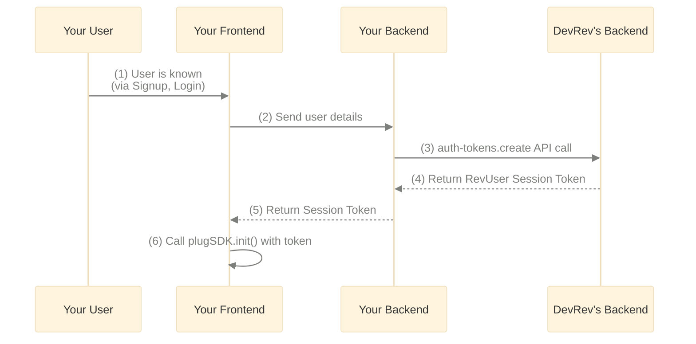

# Identify your users with Plug

Source: <https://developer.devrev.ai/sdks/web/user-identity>
Scraped: 2026-11-03

Once you have [installed Plug](installation.md), all your users who interact with the widget are created as anonymous users in the DevRev app with a random name since there is no information about the user.

For users who are logged into your website, you can identify them in Plug to enable them to view their conversation history and receive more personalized engagement.

To implement user identification, you need to generate a session token for each user who visits your website. This token is created using your application access token combined with customer information, and must be generated on your backend to keep the application token secure.



## Generate an application access token

1. In DevRev, go to **Settings > Support > Plug Tokens** through the settings icon on the top-left corner.
2. Under the **Application access tokens** panel, click **New token** and copy the token that's displayed.

> **Note:**
>   Ensure you copy your access token, as you cannot view it again.

## Generate a session token

> **Note:**
>   For security reasons, this API call must be made from the server side to prevent exposing your application access token (AAT).

Using the `rev_info` method, you can generate and recognize a user within the DevRev system by providing relevant user details. This method enables you to convey information systematically, ensuring alignment between your DevRev CRM and the structured data model. For information regarding terminologies, click [here](https://support.devrev.ai/devrev/article/ART-21830).

```bash
curl --location 'https://api.devrev.ai/auth-tokens.create' \
--header 'accept: application/json, text/plain, */*' \
--header 'authorization: <AAT>' \
--header 'content-type: application/json' \
--data-raw '{
    "rev_info": {
        "user_ref": "example@devrev.ai",
        "account_ref": "devrev.ai",
        "workspace_ref": "devrev-dev",
        "user_traits": {
            "email": "test-user@devrev.ai",
            "display_name": "Devrev Test User",
            "phone_numbers": ["+911122334455"],
            "custom_fields": {
               "tnt__<field1_name>": "value 1"
            }
        },
        "workspace_traits": {
            "display_name": "Devrev Dev",
            "custom_fields": {}
        },
        "account_traits": {
            "display_name": "Devrev",
            "domains": [
                "devrev.ai"
            ],
            "custom_fields": {
                "tnt__<field2_name>": "value x"
            }
        }
    }
}'
```

**Attributes for [users](https://developer.devrev.ai/public/api-reference/dev-users/product-builders-and-service-providers)**

| Attributes       | Description                                                                                                                | Type   | Required | Unique |
| ---------------- | -------------------------------------------------------------------------------------------------------------------------- | ------ | -------- | ------ |
| `user_ref`       | A unique user reference that the DevRev app uses for identifying your users.                                               | string | ✅        | ✅      |
| `email`\*        | The email address of the customer used for sending email notifications of any support messages.                            | string | ❌        | ✅      |
| `display_name`\* | The name of the user that's shown on the widget. If nothing is specified, a system-generated name is assigned to the user. | string | ❌        | ❌      |
| `phone_numbers`  | The customer's mobile number, which must adhere to the E.164 format.                                                       | array  | ❌        | ❌      |

* While email uniqueness is subjected to organization preferences, it is not recommended to mark emails as non-unique.

**Attributes for [workspaces](https://developer.devrev.ai/public/api-reference/rev-orgs/workspaces)**

| Attributes      | Description                                                                                                                                     | Type   | Required | Unique |
| --------------- | ----------------------------------------------------------------------------------------------------------------------------------------------- | ------ | -------- | ------ |
| `workspace_ref` | A unique reference for the user's workspace. If not provided, and an account reference is passed, the user is directly attached to the account. | string | ❌        | ✅      |
| `display_name`  | The name of the workspace that's shown on the widget.                                                                                           | string | ❌        | ✅      |

**Attributes for [accounts](https://developer.devrev.ai/public/api-reference/accounts/accounts)**

| Attributes      | Description                                                                                                                  | Type   | Required | Unique |
| --------------- | ---------------------------------------------------------------------------------------------------------------------------- | ------ | -------- | ------ |
| `account_ref`   | A unique reference for the account.                                                                                          | string | ❌        | ✅      |
| `display_name`  | The name of the account that's shown on the widget.                                                                          | string | ❌        | ✅      |
| `domains`       | The attribute must be unique. Use a format like `devrev.ai`. Inputs like `https://devrev.ai` or `www.devrev.ai` are invalid. | array  | ❌        | ✅      |
| `phone_numbers` | The phone number associated with the account must be in E.164 format.                                                        | array  | ❌        | ❌      |

> **Note:**
>   Ensure that you follow the specified format when populating phone numbers and domains in the request body.

## Pass custom attributes

To create custom attributes, see [Object customization](../../guides/object-customization.md).

You can pass the custom attributes that are created as shown below:

```json

"custom_fields": {
  "tnt__custom_attribute_name1": <value>,
  "tnt__custom_attribute_name2": <value>,
}
```

You can pass custom traits, as shown above, not only for `users` but also for `workspaces` and `accounts`.

### API status codes and troubleshooting

| Status code               | Description                                                                         | Troubleshooting                                                                                          |
| ------------------------- | ----------------------------------------------------------------------------------- | -------------------------------------------------------------------------------------------------------- |
| 200 OK                    | The request was successful and the session token would be returned in the response. | No troubleshooting required.                                                                             |
| 400 Bad Request           | The request was invalid.                                                            | Check the request body for errors. For fields like domain and phone number, check on their format.       |
| 401 Unauthorized          | The request was unauthorized.                                                       | Check if the AAT is valid and not expired.                                                               |
| 403 Forbidden             | The request was forbidden.                                                          | Check the authorization header for errors and make sure the token is a valid AAT.                        |
| 404 Not Found             | The requested resource could not be found.                                          | Verify the endpoint URL is correct.                                                                      |
| 429 Too Many Requests     | Rate limit exceeded.                                                                | Implement request throttling or wait before retrying.                                                    |
| 500 Internal Server Error | Server encounters an unexpected error.                                              | Wait and try again later. If the issue persists, contact support with the request details and timestamp. |

### How resolution works

When you send object information to DevRev, the system automatically creates or finds existing contacts, accounts, and workspaces.

DevRev offers three ways to structure your customer's data:

| Hierarchy Type   | Documents Created                           | What to Include                         | Use Case                                                                                       |
| ---------------- | ------------------------------------------- | --------------------------------------- | ---------------------------------------------------------------------------------------------- |
| **Single-level** | Contacts only                               | Only user information                   | Recommended for most B2C cases                                                                 |
| **Two-level**    | Accounts and Contacts linked to the account | User and account information            | Recommended for most B2B cases                                                                 |
| **Three-level**  | Account with linked workspaces and contacts | User, workspace and account information | Used for B2B cases but only recommended if your business model requires workspace organization |

**What happens when you send different combinations:**

User reference:

* A user reference is mandatory, ensuring its constant presence.
* If a user with the provided reference doesn't exist, the system automatically creates the user.

This approach ensures efficient management and integration of objects within the DevOrg.

| Workspace Ref | Account Ref | Results                                                                                                                                                                                                                                                                                                                                                          |
| ------------- | ----------- | ---------------------------------------------------------------------------------------------------------------------------------------------------------------------------------------------------------------------------------------------------------------------------------------------------------------------------------------------------------------- |
| ❌             | ✅           | (Most common Usage) \nIf the account doesn't exist: An account is created, and the user is linked with the account.                                                                                                                                                                                                                                              |
| ❌             | ❌           | No action on account or workspace. The user is returned.                                                                                                                                                                                                                                                                                                         |
| ✅             | ✅           | If neither exists: System creates the account first, then creates the workspace. User is linked to both.If account exists but workspace doesn't: System creates the workspace under the existing account. User is linked to both.If workspace exists under different account: System returns an error, as workspaces cannot be a part of 2 accounts. |
| ✅             | ❌           | If workspace doesn't exist: System creates a new account and workspace (if needed). User is linked to both.                                                                                                                                                                                                                                                      |

### Best practices

* Populate user traits like email and display name to make users identifiable and to prevent duplicate users across integrations.
* Maintain consistent unique identifiers across your system.
* Follow the specified formats for phone numbers and domains.
* Keep your application access token secure.

## Pass the session token

While initializing the Plug widget you pass the session token for DevRev to identify this user and thereby make the widget more customized for the user and their context.

```jsx
// You can generate this session token using the above API in your backend
const sessionToken = '<SESSION_TOKEN>'
<script type="text/javascript" src="https://plug-platform.devrev.ai/static/plug.js"></script>
<script>
  (() => {
    window.plugSDK.init({
      app_id: '<your_unique_app_id>',
      session_token: sessionToken
    })
  })();
</script>
```

## Identify users without session token

You can also pass the identifiers in the `plugSDK.init` option without generating the session token.

> **Note:**
>   This frontend user identification, by its nature, is not secure as the data is transmitted through the client side. It is recommended to use the session token method to securely identify users.

  This method is currently in beta and comes with the following limitations:

  * Unverified users cannot be converted or merged into verified users.
  * An external reference used by an unverified user cannot be reused for any other user.

```jsx
window.plugSDK.init({
  app_id: appId,
  identity: {
    user_ref: userRef,
    user_traits: { // Optional user details
      custom_fields?: object,
      display_name: 'John Doe',
      email: 'john@example.com',
      phone_numbers: ['+1234567890']
    }
  }
});
```

You can add or update the data in `user_traits` by using the `updateIdentity` method on the Plug SDK. Attached is a sample code snippet for the same.

```jsx
window.plugSDK.updateIdentity({
  user_traits: {
    custom_fields?: object; // optional
    display_name?: string; // optional
    email?: string; // optional
    phone_numbers?: string[]; // optional
  }
})
```

> **Note:**
>   Note that the `updateIdentity` method cannot be used to update the `user_ref` of the user. In order to change the identity of the user completely to a new one, you need to re-initialize Plug. See the [Changing the user identity](#changing-the-user-identity) section for more details.

## Changing the user identity

As described in the above sections, to identify a user, you need to initialize the Plug SDK with the relevant user information. Plug can only be initialized once per page load.

In most cases, this works as expected—user identification typically happens after login or signup, which causes a page reload and clears any previous Plug instance.

However, if your application needs to update the user identity without a full page refresh, you need to explicitly delete the existing Plug instance before initializing it again with the new user information.

```jsx
// Delete the existing Plug instance if it exists
if (window.plugSDK.isPlugInitialized) {
  window.plugSDK.shutdown();
}

// Re-initialize Plug
window.plugSDK.init({
  app_id: appId,

  // With session token
  session_token: sessionToken,

  // Or without session token
  identity: {},
});
```

If you're using the Plug SDK for recording user sessions, calling the `shutdown()` method will stop the ongoing session recording. Re-initializing with the `init()` method will then start a new session recording. To avoid losing continuity, you can pass the details of the ongoing session recording when re-initializing Plug.

```jsx
// Get the ongoing session details
const { sessionId, tabId } = window.plugSDK.getSessionDetails();

if (window.plugSDK.isPlugInitialized) {
  window.plugSDK.shutdown();
}
window.plugSDK.init({
  app_id: appId,
  
  // Pass the session details
  session_recording_options: {
    sessionDetails: {
      sessionId: sessionId,
      tabId: tabId,
    },
  },

  // With session token
  session_token: sessionToken,
  // Or without session token
  identity: {},
});
```
